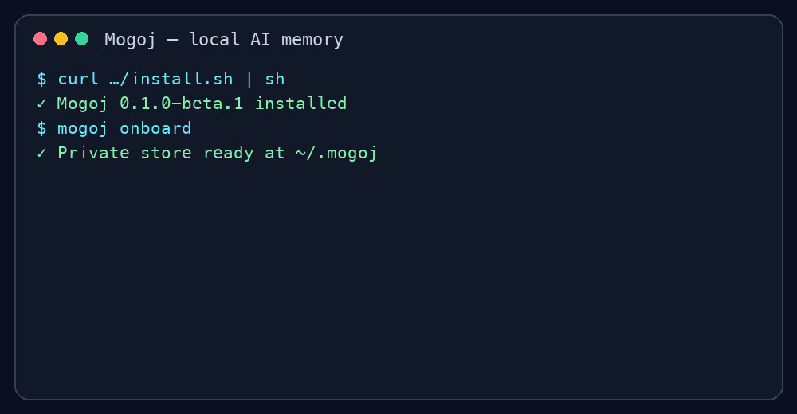

# Mogoj

Mogoj gives AI coding assistants private, durable memory on your machine—and recalls only the useful, source-cited context that fits your token budget.

> **Beta:** `v0.1.0-beta.1` is for early adopters. Back up important stores, review retrieved context before relying on it, and report bugs with synthetic data.



## First value in about 60 seconds

On macOS or Linux, copy and paste:

```bash
curl -fsSL https://raw.githubusercontent.com/Base13-Labs/mogoj/main/install.sh | sh
~/.local/bin/mogoj onboard
```

The installer explains what it creates. Onboarding asks where private memory should live, which agents you use, and whether to import existing Markdown. No repository clone, manual symlink, shell-profile edit, account, API key, or hosted database is required.

Save a decision and recall it:

```bash
~/.local/bin/mogoj save "We chose SQLite because memory must remain local." --title "Local search" --type decision
~/.local/bin/mogoj rebuild
~/.local/bin/mogoj search "Why did we choose SQLite?"
```

The answer is a bounded context packet with citations such as `docs/decisions/2026-10-10-local-search.md:L1-L3`, not a dump of every memory.

## Your data stays understandable

Markdown is the source of truth. The local SQLite FTS5 database is a disposable search accelerator. Mogoj has no telemetry, cloud account, embedding API, or automatic network upload. New files and backups are private by default; common secret patterns are blocked before save.

```text
~/.mogoj/                  your private store
├── .mogoj/                marker, migration state, backups
├── docs/                  durable Markdown memories
├── data/sessions/         session handoffs
├── data/ram/              small active-memory pointers
└── data/db/mogoj.db       rebuildable local search index
```

Read the [privacy and threat model](docs/security-model.md) before putting a store in Git or a cloud-synced folder.

## Supported agents

- CLI: works independently with any assistant or editor.
- Claude Code: install the [validated Claude plugin](docs/claude-plugin.md).
- Codex and supported ChatGPT plugin surfaces: use the [portable Agent Plugin](docs/codex-plugin.md).
- Optional debate/planning/task-running workflows are a separate add-on; they do not ship in the memory core.

See the [platform matrix](docs/platform-support.md) for tested operating systems, Python, SQLite, and integration versions.

## How recall works

Mogoj indexes Markdown locally with SQLite FTS5/BM25. Retrieval is progressive: a compact result index, one ranked snippet per document, then full content only when explicitly requested and still within budget. Recency, type, project, and relevance influence ranking. The default packet is capped at about 1,200 estimated tokens.

Mogoj is not a generic vector database. It does not require embeddings, a model call, a server, chunk hosting, or opaque binary source data. Choose a vector database when you need semantic retrieval over very large corpora or a multi-user service. Choose Mogoj when humans should own readable files, citations and migrations matter, and the context window—not storage—is the scarce resource. See the [published beta benchmark](docs/beta-retrieval-benchmark.md).

## Architecture in 30 seconds

Mogoj separates the **engine** from the **memory store**. The engine is the CLI and agent plugins in this repository. The store is a private directory owned by the user. Markdown in that store is canonical; SQLite FTS5 is a disposable, rebuildable index. Every client—terminal, Claude Code, Codex, or a supported ChatGPT plugin surface—uses the same CLI, so storage, privacy checks, root selection, retrieval budgets, and citations behave consistently.

```text
person or AI agent
        │
        ▼
agent skill/plugin ──────┐
                        ▼
terminal ───────────► mogoj CLI
                        │
             ┌──────────┴──────────┐
             ▼                     ▼
    Markdown source of truth   SQLite FTS5 index
    decisions, projects,       derived and safe
    sessions, active memory    to delete/rebuild
             │                     │
             └──────────┬──────────┘
                        ▼
              bounded cited context
```

The central design choice is to optimize the *context sent to an AI*, not to maximize stored data. Search returns a small ranked index and cited snippets first; full documents are opt-in and included only when they fit the configured budget. Read the [long-form architecture and design reasoning](docs/architecture.md) for component boundaries, write/search/migration flows, safety properties, and trade-offs.

## Upgrade, migration, and rollback

Re-run the installer to add a new engine version. Preview store changes before upgrading:

```bash
~/.local/bin/mogoj migrate --dry-run
~/.local/bin/mogoj migrate
~/.local/bin/mogoj doctor
```

Migration creates a timestamped private backup, stages SQLite separately, verifies integrity, and atomically replaces generated state. It never deletes Markdown. To restore generated state from the newest backup:

```bash
~/.local/bin/mogoj rollback
```

## Five common problems

1. **`mogoj: command not found`:** run `~/.local/bin/mogoj doctor`. The installer prints this full path specifically so no profile edit is required.
2. **“No Mogoj store found”:** run `~/.local/bin/mogoj onboard`, or pass `--root "/your/store"` before the command.
3. **Search says the index is missing:** run `~/.local/bin/mogoj rebuild`, then retry.
4. **Doctor reports SQLite FTS5 unavailable:** install a supported Python build with FTS5, then run doctor again. Mogoj cannot emulate full-text search safely.
5. **Save blocks a possible secret:** use `--redact`. Use `--allow-secrets` only after confirming the store and every backup/sync destination are private.

For a corrupted index, run `mogoj rebuild`; for an interrupted migration, rerun it—the stale staging database is removed safely. Installation details and uninstall are in [the installation guide](docs/installation.md).

## Honest beta limitations

- Native Windows has a PowerShell launcher but not yet a one-command installer; WSL is the easiest Windows path.
- Token counts use a deterministic character estimate, not a provider-specific tokenizer.
- Search is lexical BM25, so differently worded concepts may require a second query.
- No multi-device synchronization, encryption layer, GUI, hosted backup, or recovery service is included.
- Codex marketplace distribution is repo-local until accepted into a public directory.
- Three novice human installation sign-offs remain a release gate; the protocol is documented and results must not be fabricated.

## Example and handoff

Explore the fictional, non-sensitive [example store](examples/fictional-store) and the [before/after context handoff](docs/context-handoff-example.md). No Base13 Labs private memory is included.

## Contributing and support

- [Contributing](CONTRIBUTING.md)
- [Support expectations](SUPPORT.md)
- [Private vulnerability reporting](SECURITY.md)
- [Code of Conduct](CODE_OF_CONDUCT.md)
- [Open an issue](https://github.com/Base13-Labs/mogoj/issues/new/choose)

Mogoj (মগজ) means “brain” in Bengali. Copyright 2026 Base13 Labs; released under the [MIT License](LICENSE).
