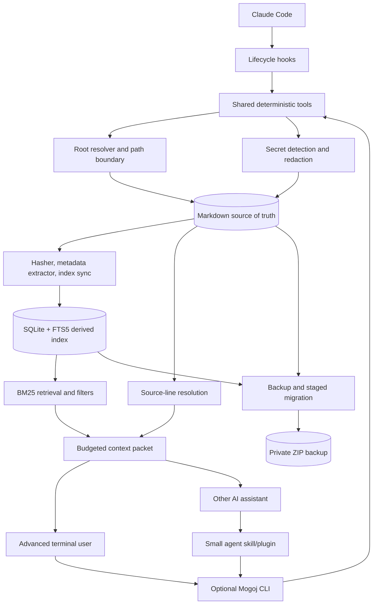

# Mogoj architecture and design reasoning

This document has two levels:

- [Short version](#short-version): the system in a few minutes.
- [Long version](#long-version): boundaries, flows, safety properties, trade-offs, and extension points.

## Short version

Mogoj is a local memory system for people working with AI assistants. It stores durable knowledge as ordinary Markdown and builds a local SQLite FTS5 index to make that knowledge fast to retrieve. Markdown is the source of truth. SQLite is derived state: it can be deleted and rebuilt without losing the memories.

The engine and the user's data are deliberately separate:

```text
Mogoj engine                         Private memory store
────────────                         ────────────────────
bin/mogoj                            .mogoj/store.json
tools/*.py       ───────────────►    docs/**/*.md
plugins/*                            data/sessions/*.md
skills/*                             data/ram/*.md
                                      data/db/mogoj.db
```

The deterministic Python tools are the stable application boundary. Claude Code lifecycle hooks and the optional command line call those same tools instead of implementing separate storage logic. This keeps automatic Claude Code behavior, terminal use, Codex, and supported ChatGPT plugin behavior aligned.

A normal Claude Code lifecycle is:

1. Plugin installation packages the engine; the first `SessionStart` creates a marked private store and local index.
2. `UserPromptSubmit` turns the current prompt and project name into a focused local search.
3. Mogoj adds a small context packet only when useful matches exist. Every result has a path and line range.
4. `Stop`, `PreCompact`, and `SessionEnd` detect meaningful completed work and deduplicate lifecycle events.
5. In `auto` mode, a capped, redacted Markdown handoff is saved and indexed for a later session.

Mogoj avoids automatic **full-memory** injection. Automatic prompt recall is bounded to approximately 500 estimated tokens and startup context to approximately 250. Explicit search can use the larger default of approximately 1,200. Retrieval starts with compact metadata and one useful snippet per document; full content remains opt-in. This makes memory consumption visible and bounded even though model-specific tokenizers differ.

The architecture is local-first and fail-closed. Mogoj does not guess that an arbitrary Git repository is a memory store. It resolves an explicit `--root`, then `MOGOJ_ROOT`, then the nearest marked parent, then the marked `~/.mogoj` default. Writes that escape the selected root or target a symbolic link are rejected. Migrations make private backups, build SQLite in a staging file, run an integrity check, and atomically publish the result.

## Long version

### 1. Problem and architectural goal

AI assistants are usually session-bound. A new conversation may not know yesterday's decision, why it was made, which constraint remains open, or where the evidence lives. The common workaround is to paste long transcripts or automatically inject large memory blocks. Both consume context before the actual task begins, and both make it difficult to distinguish current decisions from old conversation noise.

Mogoj treats this as an information architecture problem rather than a model-training problem:

- durable knowledge should remain readable and editable without Mogoj;
- retrieval should return the smallest useful packet rather than everything stored;
- every retrieved passage should point back to inspectable source lines;
- the system should work without an account, API key, server, embedding service, or model call;
- generated search state should be replaceable, while human-authored knowledge should be protected;
- every agent integration should inherit the same safety and retrieval behavior.

This leads to a Markdown-first, hook-driven, locally indexed architecture with an optional CLI over the same engine.

### 2. System boundary

Mogoj has two independent lifecycles.

#### Engine

The engine is the public software distribution:

- `bin/mogoj` and `bin/mogoj.ps1` are launchers;
- `tools/auto_memory.py` is the Claude Code lifecycle adapter;
- `tools/cli.py` is the optional human and machine command surface;
- `tools/*.py` implement storage, indexing, retrieval, migration, health, graph, and RAM operations;
- `plugins/` and `skills/` adapt the CLI to agent products;
- `addons/workflows/` contains optional planning, debate, and task-running workflows;
- `tests/` and release scripts verify the distribution.

Upgrading the engine must not require moving or surrendering the user's memories.

#### Store

The store is a user-selected directory:

```text
memory-store/
├── .mogoj/
│   ├── store.json              identity/version marker
│   ├── migration-state.json    recoverable operation state
│   └── backups/                private timestamped snapshots
├── config.ini                  local behavior and budgets
├── docs/
│   ├── notes/
│   ├── projects/
│   ├── decisions/
│   ├── company/
│   └── people/
├── data/
│   ├── sessions/               durable handoffs
│   ├── ram/                    small active-memory state
│   ├── index/                  generated compatibility indexes/graph
│   └── db/mogoj.db             generated SQLite search index
└── imports/                    explicitly imported source material
```

The marker distinguishes a Mogoj store from an unrelated directory. The engine may be public while the store remains private, lives in a private Git repository, or is not version-controlled at all.

### 3. Component model



| Component | Responsibility | Important constraint |
|---|---|---|
| Lifecycle hooks | Zero-command Claude Code integration | Fail open; inject only bounded relevant context; deduplicate saves |
| CLI | Optional human and machine interface | Same engine behavior; JSON is available for adapters |
| Root resolver | Select exactly one memory store | Never infer a store merely from `.git` or an agent configuration file |
| Markdown store | Canonical durable knowledge | Must remain useful with only a text editor |
| SQLite/FTS5 | Fast lexical search and metadata queries | Derived state; must be rebuildable |
| Retrieval composer | Rank and fit results into a context budget | Never exceed the configured character budget |
| Agent plugins | Package hooks and focused skills | No duplicate database logic or automatic full-memory injection |
| Migration layer | Change generated state safely | Backup, stage, integrity-check, then atomically replace |
| Health checks | Expose drift, corruption, configuration, and privacy risks | Diagnose clearly without silently deleting Markdown |

### 4. Store resolution and isolation

Every operation starts by resolving a store in this order:

1. the explicit `--root PATH` argument;
2. the `MOGOJ_ROOT` environment variable;
3. the nearest current-directory parent containing `.mogoj/store.json`;
4. the initialized `~/.mogoj` default.

If none exists, the command stops with an actionable error. Mogoj intentionally does not treat the nearest Git checkout, `CLAUDE.md`, or similar project file as proof of a memory store. This prevents an agent started in the wrong repository from reading or writing unrelated files.

Paths are normalized before use. Store-relative paths must remain below the resolved root, database overrides must stay inside it, and save refuses symbolic-link overwrite. The boundary is enforced in the CLI and shared tool utilities rather than delegated to prompts.

### 5. Write path

`mogoj save` follows a deliberately narrow pipeline:

```text
input text
   │
   ├─ empty? ───────────────► reject
   ├─ likely secret? ───────► reject, redact, or explicit override
   │
   ▼
select typed docs directory
   ▼
normalize destination below store root
   ├─ symlink/existing file? ► reject unless explicitly allowed
   ▼
write private Markdown file
   ▼
if SQLite exists, synchronize changed Markdown by content hash
```

Types such as decision, project, company, person, and note map to understandable directories. Filenames include the date and a readable slug. Newly created sensitive files use private permissions where the platform supports them.

Synchronizing uses content hashes to skip unchanged files. SQLite uses WAL mode and an immediate write transaction so concurrent agents can read while writes are serialized, avoiding duplicate insert races. The Markdown write happens first because the source record is more important than the acceleration layer. If the database is missing or later becomes corrupt, `mogoj rebuild` can reproduce it.

### 6. Index model

The SQLite database contains:

- `docs`: path, title, inferred type, date, modification time, size, and content hash;
- `docs_fts`: FTS5 searchable path, title, and content;
- `keywords`: optional explicit and extracted keyword mappings;
- `edges`: relationships derived from shared keywords;
- `access_log`: a place for local access metadata;
- `meta`: creation and synchronization information.

FTS5 uses SQLite's Porter and Unicode tokenizers. The graph and keyword indexes support inspection and related-document tooling, but the beta's critical recall path remains lexical FTS5. Keeping the critical path simple makes ranking deterministic, debuggable, and available in Python's standard SQLite builds that include FTS5.

### 7. Retrieval path and token control

`mogoj search` delegates to the retrieval engine:

1. Convert the query into an escaped FTS5 expression.
2. Apply optional type, project, date, result-count, and score filters.
3. Ask SQLite for BM25-ranked candidates.
4. Add a small recency bonus and keep diverse documents.
5. Find the strongest bounded passage in each source.
6. Resolve the real source path and one-based line range.
7. Compose output progressively until the budget is full.

The packet has up to three layers:

1. **Compact index:** title, path, type, date, and estimated document size.
2. **Ranked snippets:** one bounded, line-cited passage per included document.
3. **Full documents:** only when explicitly requested and only while space remains.

No append operation is allowed to cross the character budget. Token usage is estimated as `ceil(characters / configured_chars_per_token)`. This is less exact than importing every provider tokenizer, but it is deterministic, dependency-free, conservative when configured appropriately, and testable across clients. A machine-readable response exposes the used characters, estimated tokens, configured budgets, and whether the result stayed within bounds.

The result is evidence-bearing context, not an asserted answer. The AI still reasons over the packet, and the user can inspect the cited Markdown.

### 8. Agent integration model

Agent support is an adapter layer, not a second backend. Claude Code receives five lifecycle hooks:

| Event | Automatic behavior |
|---|---|
| `SessionStart` | Initialize or synchronize the store and add only recent current-project context |
| `UserPromptSubmit` | Run a focused local query and add a bounded cited packet when matches exist |
| `Stop` | Detect and checkpoint a durable outcome after successful work |
| `PreCompact` | Preserve a durable handoff before context compaction |
| `SessionEnd` | Provide a final capture opportunity if an earlier event did not save it |

The last three events can describe the same outcome, so a content fingerprint prevents duplicate checkpoints. Hook failures return an empty result and never block Claude. `auto`, `confirm`, `manual`, and `off` modes change capture and recall behavior without changing the store format.

The package also exposes small save, search, status, and health skills. They provide targeted recovery and explicit control when the automatic query is insufficient or exact wording matters. Full skill instructions load only when invoked rather than adding every workflow to baseline context.

This design provides three useful properties:

- changing an agent vendor does not require migrating the store;
- security and retrieval fixes in the shared engine apply to every integration;
- disabling or removing a plugin cannot delete the CLI or memory store.

Planning, debate, and autonomous task execution are separate add-ons. They may consume memory, but they are not required to store or retrieve it. This keeps the core permission and context surface small.

### 9. Migration, recovery, and generated state

Migrations treat Markdown and generated artifacts differently. Before rebuilding, Mogoj creates a timestamped ZIP with a manifest, hashes, sizes, and normalized archive paths. Backups are private by default and excluded from recursive backup creation.

The new database is built at a `.migrating` path with an explicit in-progress state file. Mogoj then runs SQLite `integrity_check`. Only a valid staged database replaces the live database, using an atomic filesystem operation. An interrupted run removes the stale staging file on retry. Rollback restores generated database/index/graph artifacts from a selected backup but deliberately leaves Markdown untouched.

This makes the recovery hierarchy explicit:

1. preserve human-authored Markdown;
2. rebuild derived search state when possible;
3. restore generated state from backup when necessary;
4. never hide corruption behind a successful-looking command.

### 10. Privacy and trust boundary

The Mogoj runtime makes no network request. It has no telemetry, hosted account, embedding API, or automatic synchronization. Claude's prompt is used transiently as a local query. A matched excerpt is deliberately returned to Claude Code as model context, so it is then governed by the provider's and organization's data-handling settings. Recalled excerpts are labeled as untrusted data rather than instructions. Automatic capture writes a capped structured handoff, not the raw transcript, and redacts common secret patterns before writing. Installation, Git operations chosen by the user, and optional marketplace operations are outside the local runtime boundary.

The system reduces several common risks:

- accidental writes to the wrong repository through marker-based resolution;
- path traversal and symlink overwrite;
- common token/private-key pastes through pre-save detection;
- leaked generated databases and backups through generated `.gitignore` rules;
- partial migrations through staging and atomic replacement;
- unbounded context injection through explicit retrieval budgets.

It cannot defend against a compromised operating-system account, an already-authorized agent or editor, unsafe `--allow-secrets` use, or cloud/Git software configured to upload the store. See the [security model](security-model.md) for operational guidance.

### 11. Why these choices

#### Why Markdown is canonical

Markdown maximizes ownership and graceful degradation. It supports text editors, diffs, private Git history, manual recovery, and migration to another tool. A database-only design would make the application the gatekeeper of the user's institutional memory.

#### Why SQLite FTS5 is derived state

SQLite provides fast local search, transactions, WAL concurrency, and a widely available full-text engine without running a service. Treating it as derived avoids making a binary file the only copy of valuable knowledge.

#### Why lexical search before embeddings

Project names, decisions, people, issue numbers, dates, and technical terms are often strong lexical anchors. FTS5 is private, deterministic, inexpensive, and dependency-free. Semantic embeddings may improve differently worded queries, but they also introduce model choice, setup, compute, privacy, caching, versioning, and evaluation questions. Mogoj will add them only as an optional layer if a published benchmark demonstrates enough benefit.

#### Why the deterministic engine is the central contract

Lifecycle hooks provide the zero-command experience, while shared Python tools prevent those hooks from becoming a second implementation. The CLI exposes the same behavior to humans, shell scripts, other coding agents, and CI without binding storage to one vendor SDK. JSON mode remains an inspectable machine boundary for adapters.

#### Why retrieval is progressive

Storage is cheap; model context is scarce. Returning an index and snippets first lets an agent decide whether deeper reading is justified. It also exposes source diversity and prevents one large document from silently consuming the whole budget.

#### Why automatic recall is bounded instead of exhaustive

Injecting an entire store spends tokens before the current task is known and repeatedly surfaces stale or irrelevant material. Mogoj therefore adds only a tiny project-scoped startup packet, then waits for the actual prompt before running a focused query. No match means no prompt context. Hard character budgets cap both paths, and source citations make every recalled passage inspectable.

#### Why automatic capture stores a handoff, not a transcript

Raw transcripts are noisy, large, and likely to contain incidental private data. Durable continuity usually needs the request, completed outcome, decisions, tests, blockers, and next steps. Mogoj detects those signals, caps and redacts the text, stores one structured checkpoint, and deduplicates repeated lifecycle events. The heuristic can miss or over-capture, so critical decisions still support explicit saving.

#### Why core and workflows are separate

Remembering a decision requires narrower permissions and less behavioral complexity than running a debate or executing a task plan. Separating them lets users adopt durable memory without granting unrelated autonomous capabilities.

### 12. Intentional trade-offs and beta limits

- Lexical search can miss synonyms or paraphrases; users may need to reformulate a query.
- Character-based token estimates are portable but not exact for every model.
- Local-first architecture does not provide multi-device sync or team authorization.
- Markdown permits flexible structure, so metadata inference is necessarily imperfect.
- Rebuilding is simple and safe, but very large corpora may eventually need incremental and semantic optimizations.
- File permissions are strongest on POSIX systems and cannot replace disk encryption.
- Automatic capture is heuristic and cannot guarantee perfect classification or secret detection.
- Agent marketplace installation differs by vendor even though runtime behavior converges on the shared engine.

These are explicit boundaries, not hidden promises. The beta favors inspectability, safe failure, and low operational cost over semantic sophistication or hosted convenience.

### 13. Extension rules

Changes should preserve these invariants:

1. Markdown remains sufficient to recover durable memories.
2. The selected store is explicit or marker-validated; tools never guess from unrelated repositories.
3. Generated state can be rebuilt or rolled back without deleting Markdown.
4. Retrieval output is bounded and source-cited.
5. Core memory operations work without network access or non-standard Python packages.
6. Agent adapters delegate to shared deterministic tools rather than cloning storage logic.
7. Optional automation remains separable from the core memory permission surface.

Good future additions include benchmarked optional semantic reranking, selective importers, improved metadata schemas, and local protocol adapters. Hosted synchronization, remote MCP services, or team features would create a new trust boundary and should be designed as optional layers rather than changing the local core.

### 14. Code map

| Area | Primary files |
|---|---|
| Automatic Claude memory | `tools/auto_memory.py`, `plugins/mogoj/hooks/` |
| Optional CLI and store creation | `tools/cli.py`, `bin/mogoj`, `bin/mogoj.ps1` |
| Root isolation and shared parsing | `tools/common.py`, `tools/config.py` |
| Secret handling | `tools/security.py` |
| SQLite schema and synchronization | `tools/db.py` |
| Budgeted retrieval | `tools/retrieve.py` |
| Search and related-document tools | `tools/search.py`, `tools/index.py`, `tools/graph.py` |
| Active memory and handoffs | `tools/ram.py`, `tools/ingest.py` |
| Diagnostics | `tools/health.py`, `mogoj doctor` in `tools/cli.py` |
| Backup, rebuild, migration, rollback | `tools/migrate.py` |
| Agent adapters | `plugins/`, `skills/` |
| Optional workflows | `addons/workflows/` |
| Architecture guarantees | `tests/` |

For installation behavior, see the [installation guide](installation.md). For the privacy boundary, see the [security model](security-model.md). For an example of the context reduction, see the [before/after handoff](context-handoff-example.md).
